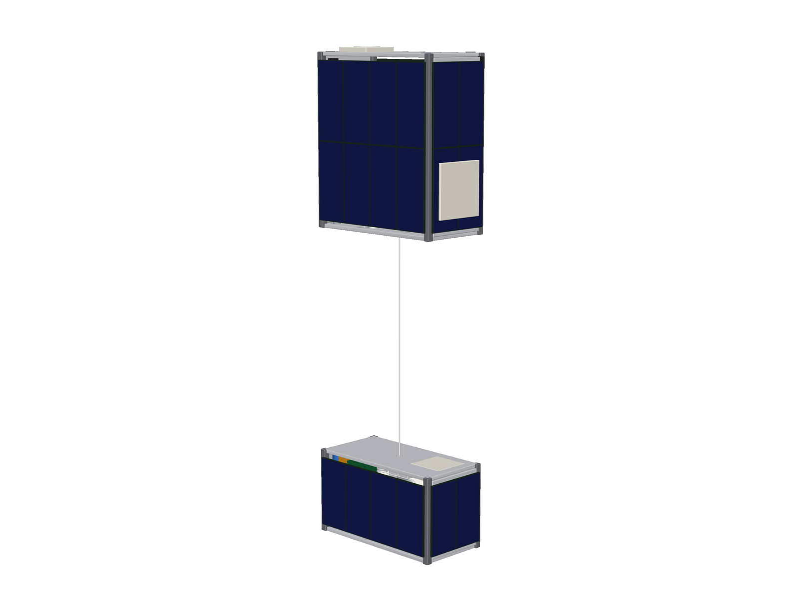
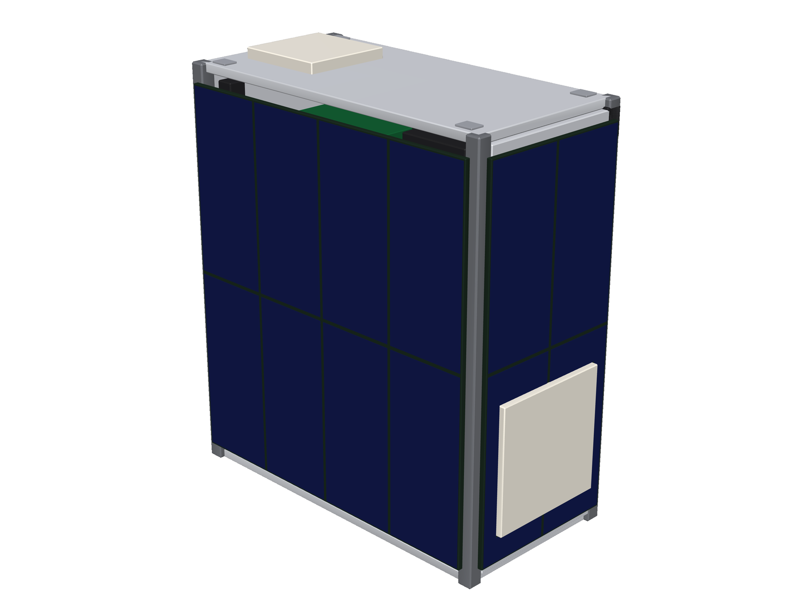
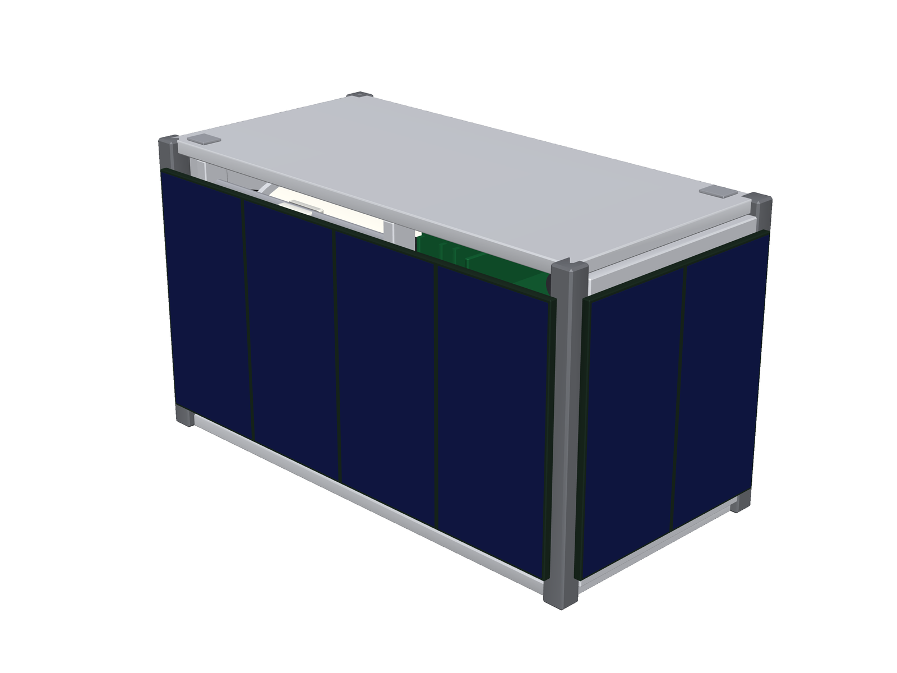
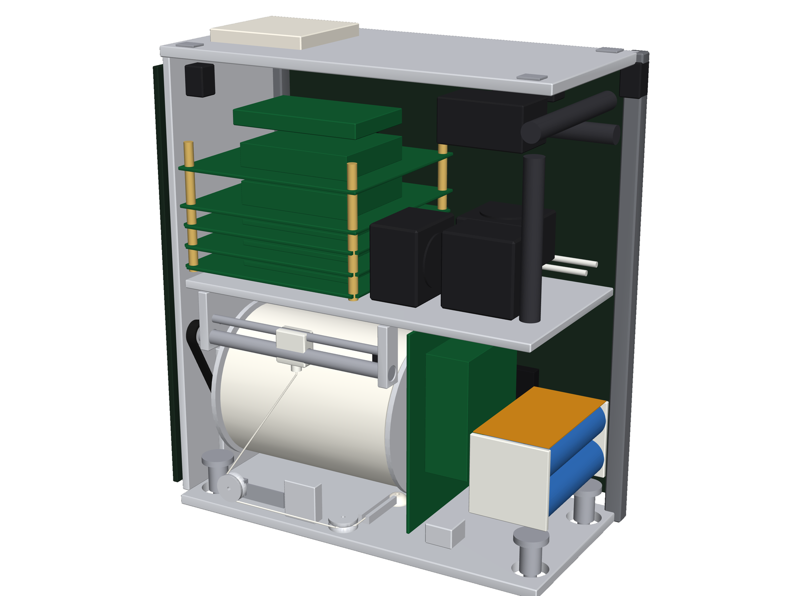
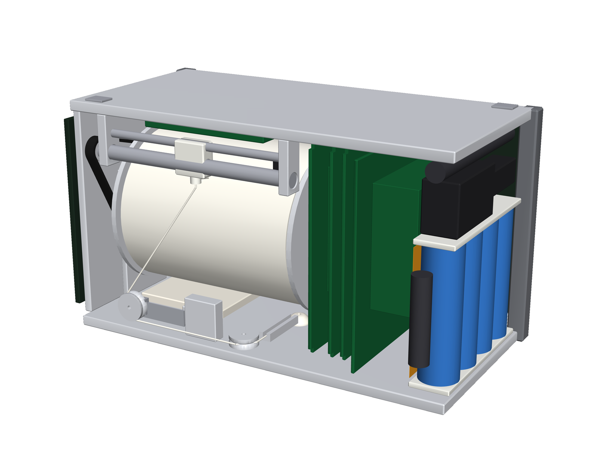
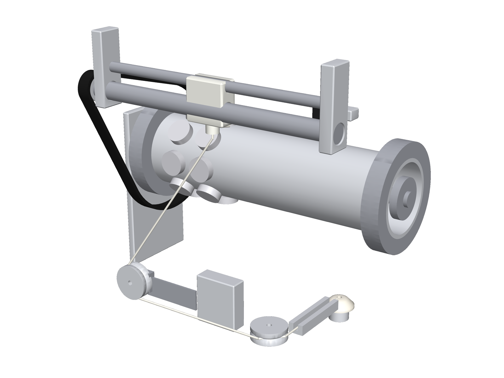

# TIGRE 4U/2U · Mechanical CAD

<p align="center"> </p>

**TIGRE** is a two-body 6U CubeSat for the CSA CUBICS 2026 programme. At launch it is a standard 6U (2x3U). In
orbit it separates into a **mother** (2x2U) and a **daughter** (2x1U), joined by a Dyneema line that a winch in
each body pays out to 500 m and retrieves to 5 m, cycle after cycle. This repository holds the mechanical CAD of
both bodies and of the winch module.

| | |
|---|---|
| Revision | **Rev A**, 2026-11-18 |
| Author | Grover Aruquipa, Université Laval |
| Mother | 200 x 100 x 227 mm, 92 parts, 4.00 kg dry |
| Daughter | 200 x 100 x 113.5 mm, 73 parts, 2.57 kg dry |
| Stowed | 6U, 2x3U deployer; largest protrusion 6.0 mm (CDS limit 6.5 mm) |
| Winch | fixed hollow axle with motor, gearhead, brake and encoder; drum on two SKF 61806 bearings; 296 m of line per drum; level wind; eddy-current backup brake |
| Formats | STEP AP214 (assemblies and single parts), STL, GLB, BOM in Excel and CSV |

## Gallery

| Mother | Daughter | Winch module |
|---|---|---|
|  |  |  |
|  |  |  |

## Repository layout

```
assembly/      TIGRE_6U_stowed.step, TIGRE_Mother_2x2U.step, TIGRE_Daughter_2x1U.step, TIGRE_winch_module.step
parts/         <body>/<subassembly>/<part number>_<name>.step and .stl, one file per part
glb/           the assemblies for web and AR/VR viewers
renders/       the images above
BOM_TIGRE_4U2U.xlsx   indented BOM, purchased parts, mass summary, datasheet sources
BOM.csv        the same BOM as one flat table
verification.json     design checks (below)
```

## Assembly tree

```
TGR-6U  TIGRE 4U/2U, stowed 6U (2x3U)
├── TGR-M  Mother 2x2U
│   ├── TGR-M-STR  Structure (9 parts)
│   ├── TGR-M-WIN  Winch module (31 parts)
│   ├── TGR-M-PWR  Power (13 parts)
│   ├── TGR-M-AVI  Avionics and comms (16 parts)
│   ├── TGR-M-ADC  Attitude control (10 parts)
│   ├── TGR-M-PLD  Payload (5 parts)
│   └── TGR-M-SEP  Separation (8 parts)
└── TGR-D  Daughter 2x1U
    ├── TGR-D-STR  Structure (8 parts)
    ├── TGR-D-WIN  Winch module (31 parts)
    ├── TGR-D-PWR  Power (13 parts)
    ├── TGR-D-AVI  Avionics and comms (8 parts)
    ├── TGR-D-ADC  Attitude control (5 parts)
    ├── TGR-D-PLD  Payload (5 parts)
    └── TGR-D-SEP  Separation (3 parts)
```

Part numbers follow `TGR-<body>-<subassembly>-<NNN>`: body `M` (mother) or `D` (daughter); subassembly `STR`
structure, `WIN` winch, `PWR` power, `AVI` avionics and comms, `ADC` attitude control, `PLD` payload, `SEP`
separation. Every product name in the STEP files starts with its part number, so the tree reads the same in any
CAD tool and no two parts share a name.

| Subassembly | Code | Mother parts | Mother mass (g) | Daughter parts | Daughter mass (g) |
|---|---|---:|---:|---:|---:|
| Structure | `TGR-x-STR` | 9 | 610 | 8 | 345 |
| Winch module | `TGR-x-WIN` | 31 | 943 | 31 | 942 |
| Power | `TGR-x-PWR` | 13 | 838 | 13 | 556 |
| Avionics and comms | `TGR-x-AVI` | 16 | 490 | 8 | 262 |
| Attitude control | `TGR-x-ADC` | 10 | 684 | 5 | 185 |
| Payload | `TGR-x-PLD` | 5 | 218 | 5 | 218 |
| Separation | `TGR-x-SEP` | 8 | 212 | 3 | 60 |
| **Total** | | **92** | **3,995** | **73** | **2,566** |

Dry masses, before the 15 % system margin. The BOM lists 17 distinct purchased components with their
manufacturer part numbers and datasheet links.

## Conventions

- Units: millimetres. STEP AP214 with names and colours; colours follow the material of each part.
- Each body has its own frame: origin at the **centre of its separation face**, **z** into the body, **x** along
  the 200 mm side, **y** along the 100 mm side (the ram face is +y). The line leaves through the origin.
- Single parts are saved **in place**, in body coordinates: importing all the files of a body rebuilds it with no
  mates. In the stowed 6U the daughter is turned half a turn about y (x -> -x, z -> -z).

## Opening the files

- **SolidWorks, Inventor, CATIA, NX, Creo, Solid Edge:** open the assembly STEP; the tree, names and colours come in.
- **Fusion 360, Onshape:** upload the assembly STEP; each part becomes a component inside its subassembly.
- **FreeCAD:** File > Import with colours, or build an assembly from the part files.
- **Blender, viewers, 3D printing:** STL (mm) or GLB.

## Integration sequence (each body)

1. Structure: separation plate, rails and side walls; outer end plate off.
2. Winch module, built and tested as one unit on the bench: axle with motor, gearhead, brake and encoder; eddy-current
   magnets; drum on its bearings; output clutch; level wind with lead screw, guide rod, carriage and timing belt;
   line wound. It mounts on the separation plate through the axle bracket; the lead-screw brackets hang from the
   bulkhead (mother) or the outer plate (daughter).
3. Line path on the separation plate: tensioner sheave on its leaf spring and load cell, redirect sheave, channel,
   exit fairlead and exit tube; the line is threaded before the electronics go in.
4. Battery, then the PC/104 stack (horizontal above the bulkhead in the mother, vertical beside the drum in the
   daughter) and the Langmuir probe module.
5. Attitude control: reaction wheels (mother only), magnetorquers, sensors.
6. Harness, side solar panels, antennas, outer end plate.
7. Stowing: the two halves of the hold-down face each other; separation springs and switches act on the faces.

## Design checks

| Check | Result |
|---|---|
| Interference between solids (Boolean, above 1 mm³) | none in either body; none between bodies when stowed |
| Clearance between parts not meant to touch | at least 0.5 mm everywhere (exact solid distances); tightest: battery to +x wall, 1.5 mm mother, 0.5 mm daughter |
| Protrusion beyond the rail envelope | 6.0 mm at most (CDS: 6.5 mm) |
| Interior volume used | 21 % mother, 32 % daughter |
| Solar cells on the side panels | 1039 cm² mother, 490 cm² daughter (cell layout indicative) |
| Files | 165 parts and 17 assembly nodes read back from the stowed STEP; all 165 single-part files read back with their volume (0 failures) |

## Status of this revision

- Radios of the mother: drawn at the height of the mass budget; the commercial candidates in the BOM are taller and
  heavier.
- EPS and OBC of the daughter: two thin boards; standard commercial boards would not fit beside the link radio and
  the probe module.
- S-band patch antenna, magnetorquers and hold-down: drawn at budget size; candidates listed in the BOM.
- Fasteners, board-to-board connectors and harness routing are not modelled in detail.

© 2026 Grover Aruquipa, Université Laval. TIGRE mission, CUBICS 2026.
