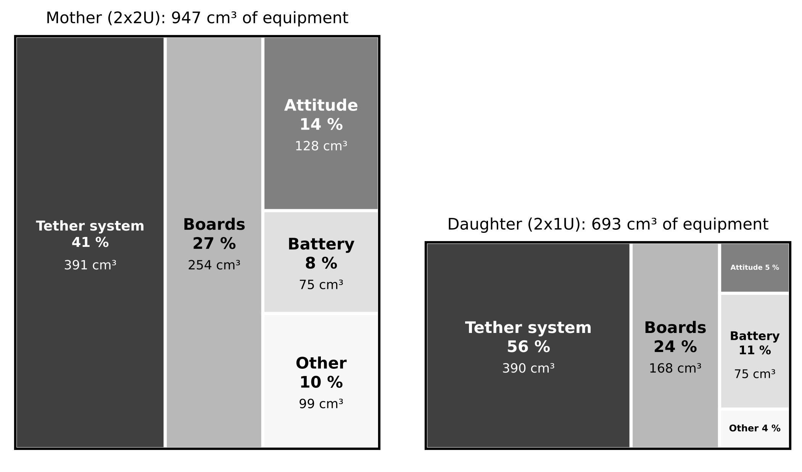

# TIGRE 4U/2U · Mechanical CAD

 

 The launches as a 2x3U (6U) unit and, in orbit,
separates into a **mother** (2x2U) and a **daughter** (2x1U) joined by a line. A winch in each body pays the line
out to 500 m and reels it back to 5 m.

| | |
|---|---|
| Mother | 200 x 100 x 227 mm, 3.78 kg |
| Daughter | 200 x 100 x 113.5 mm, 2.52 kg |
| Author | Grover Aruquipa, Université Laval |

## Views

| Mother | Daughter | Winch |
|---|---|---|
|  |  |  |

## Volume by subsystem

Share of the volume taken by equipment in each body, from the solid volume of the CAD parts.

## Files

- `assembly/`: STEP assemblies of the stowed 6U, each body and the winch module
- `parts/`: every part as STEP and STL, sorted by body and subsystem
- `glb/`: models for web viewers
- `BOM_TIGRE_4U2U.xlsx`: mass of every part with its source and file name, the purchased components with their datasheets, and a summary by subsystem

Part numbers follow `TGR-<body>-<subsystem>-<NNN>`, for example `TGR-M-WIN-009` (mother, winch, item 9).

## Notes

- Units in mm. Each body's origin is the centre of its separation face, with z pointing into the body.

 2026 Grover Aruquipa, Université Laval
